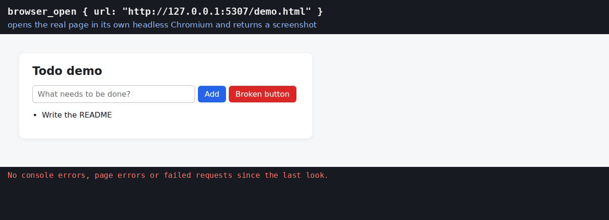

# web-vision

An **MCP server** that lets a coding agent **see and use a real web frontend**: local, on the LAN or hosted, over
http or https. It drives its own headless Chromium (no browser extension, not your browser). After **every** action
it returns:

- a **real screenshot** of the page;
- a truthful report of what happened: JavaScript errors, console errors, failed requests, dialogs, new tabs.

It was built for and used by [opencode](https://opencode.ai) (v2) coders and by Claude Code. Both use it on the
[open-SpreadJS](https://github.com/TomP321/open-SpreadJS) project to check their own UI changes and to measure a
reference product as a black box.



The animation is a real session: every frame is the screenshot web-vision returned, with the tool call above it and an
excerpt of the text report below. The page is [media/demo.html](media/demo.html). Its "Broken button" throws a
`TypeError`, and the tool reports it with the stack.

## Tools

| Tool | What it does |
|---|---|
| `browser_open` | opens a URL and shows it. Always loads the **current** version (reloads if already open) |
| `browser_look` | screenshot of the page as it is now, without reloading (state is kept), plus everything that happened since the last look. `reload: true` to reload |
| `browser_act` | **operates** the page and returns a screenshot, **also when the action fails**, with the reason |
| `browser_console` | console, errors, dialogs, tabs and network (fetch/XHR with status), no screenshot |
| `browser_eval` | runs JavaScript in the page and returns the value as JSON, to **read** state; it warns when the code sends requests that change data |

`browser_act` kinds: `click`, `dblclick`, `right_click`, `hover`, `focus`, `click_at` (canvas, maps), `type`, `clear`,
`press` (keys and chords, `repeat`), `select`, `check`, `uncheck`, `set_value` (React/Vue notice it), `upload`, `drag`
(onto a target or by `dx`/`dy`), `scroll`, `wait_for`, `back`, `forward`, `switch_tab`, `close_tab`. Elements inside an
iframe take `frame`; if you forget it, the tool tells you which iframe holds the element.

## Use it from opencode (v2)

Two pieces: the MCP server and a tiny hooks plugin.

1. **Install the server** (Node.js 20+):

   ```bash
   git clone https://github.com/TomP321/web-vision.git ~/web-vision
   cd ~/web-vision
   npm ci --omit=dev
   node node_modules/playwright-core/cli.js install --no-shell chromium   # once, ~180 MB
   node selftest.mjs                                                     # must print "selftest ok"
   ```

2. **Register it** in `~/.config/opencode/opencode.json` (see [opencode/opencode.mcp.example.json](opencode/opencode.mcp.example.json)).
   Use the absolute path of `node`: with nvm it is not on opencode's PATH.

   ```json
   "mcp": {
     "web-vision": {
       "type": "local",
       "command": ["/home/you/.nvm/versions/node/v20.20.2/bin/node", "/home/you/web-vision/server.mjs"],
       "enabled": true,
       "environment": { "WEB_VISION_CONFIG": "/home/you/.config/opencode/web-vision.json" }
     }
   }
   ```

   Copy [opencode/web-vision.json](opencode/web-vision.json) to `~/.config/opencode/` and set `defaultUrl` to your dev
   server. In opencode the tools are named `web-vision_browser_look`, `web-vision_browser_open`, `web-vision_browser_act`,
   `web-vision_browser_console` and `web-vision_browser_eval`.

3. **Install the hooks plugin**: copy [opencode/browser-vision-hooks.ts](opencode/browser-vision-hooks.ts) to
   `~/.config/opencode/plugin/` and [opencode/browser-vision.json](opencode/browser-vision.json) to `~/.config/opencode/`.
   It does the two things an MCP server cannot do:
   - after `edit`/`write`/`patch` it appends *"the running page is now stale — call web-vision_browser_look …"* to the
     tool result, so the model looks at what it just changed;
   - it keeps only the screenshots of the last `keepRecentImages` messages in the history (in blocks of `dropBatch`, so
     the server's prompt cache stays valid), so old images do not eat the context.

How the open-SpreadJS coders used it: opencode v2.1.4 running `opencode run --auto` against a local
Qwen3.8-Flash-Next ("Strata") model, with this server registered as above. The coders reached the tools from
opencode's code-execution tool (`await tools["web-vision"].browser_open({...})`) and with direct tool calls.

## Use it from Claude Code

```bash
bash install.sh          # npm ci, Chromium, selftest, then: claude mcp add -s user web-vision -- node <dir>/server.mjs
bash uninstall.sh        # unregister (add --purge to delete its files and the saved login)
```

`WEB_VISION_SCOPE=local bash install.sh`, run from a project folder, registers it for that project only. The tools
appear as `mcp__web-vision__browser_*`. The detailed manual in Italian is in [README.it.md](README.it.md).

## Configuration (`config.json` or the file named by `WEB_VISION_CONFIG`)

| Key | Default | Meaning |
|---|---|---|
| `defaultUrl` | `http://127.0.0.1:5173` | page opened when a tool is used without a URL |
| `autoStart` | `false` | if `defaultUrl` is local and down, run `npm run dev` (or `start`/`serve`) in the project folder |
| `idleCloseMinutes` | `10` | close Chromium after N minutes without calls (`0` = never); it reopens on the last page |
| `viewport` | `1280×720` | window size |
| `jpegQuality` | `75` | screenshot quality (higher = more context tokens) |
| `ignoreHTTPSErrors` | `true` | accept self-signed / internal-CA certificates |
| `keepLogin` | `true` | keep cookies, localStorage and IndexedDB between sessions (`~/.cache/web-vision/storage-state.json`, mode 600) |
| `dialogs` | `"accept"` | `alert`/`confirm`/`prompt`: `"accept"` or `"dismiss"` (always reported) |
| `httpCredentials` | `null` | `{ "username", "password", "origin" }` for HTTP Basic/Digest login |
| `extraHTTPHeaders`, `extraHTTPHeadersHosts` | `null` | extra request headers, optionally only for some hosts |
| `actionTimeoutMs` | `5000` | how long to wait for an element |
| `navigationTimeoutMs` | `45000` | page load timeout (keep it under ~55 s: MCP clients give up at 60 s) |
| `evalTimeoutMs` | `30000` | maximum `browser_eval` duration |
| `maxFullPageHeight` | `3000` | `full_page` captures at most this height (taller images reach the model unreadable) |
| `executablePath`, `launchArgs` | auto | a specific Chromium and its flags |

## What it does so the model is not misled

- **The HTTP cache is off and service workers are blocked**, so a reload never shows new HTML with old CSS/JS.
- **It waits for the page to react** after an action: finite CSS animations, a quiet DOM (toasts appear in the
  screenshot) and a quiet network. The HMR websocket does not count. An app can also signal `window.__renderReady = true`.
- **No false alarms on the network**: a request the browser abandons after the server already answered is not reported
  as a failure, and a failed navigation is reported once, not twice.
- **Frozen pages are detected** (an endless loop in the page): Chromium is restarted in a few seconds and the model is
  told that the page state is gone. A page that freezes while loading is not reopened.
- **Errors are made actionable**: connection refused, wrong scheme, HTTP auth, element hidden or covered (for example
  by the Vite error overlay), element inside an iframe. Stack line numbers refer to the transformed code; the tool says so.

## Limits

2FA/SSO/CAPTCHA logins must be done once by a human (the login is then kept). The tool handles one iframe at a time,
uploads files from the machine where it runs, and runs one browser per session with calls serialized. Each screenshot
costs about 1,000–1,500 context tokens at 1280×720.

## License

MIT
